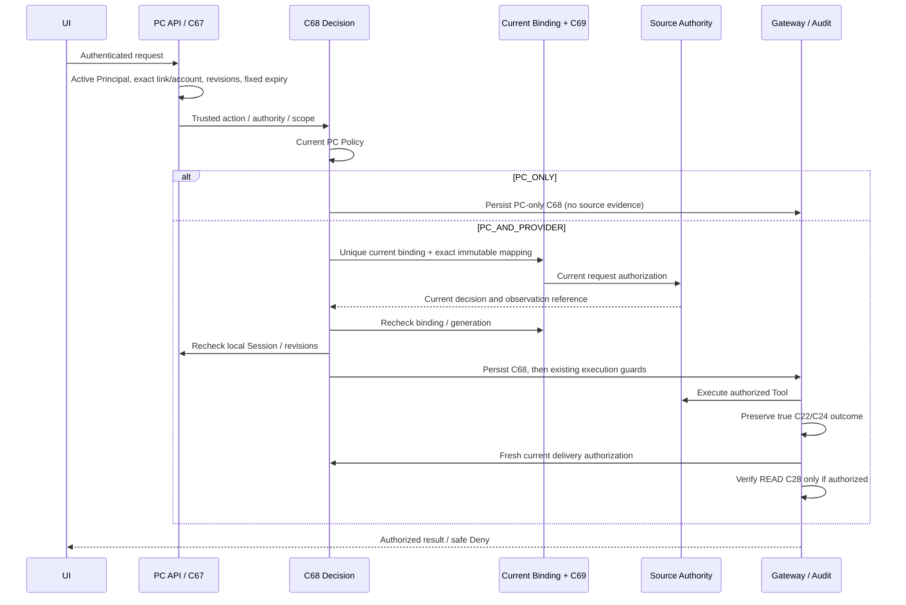

# PC-AUTHORIZATION-MVP-01 live verification

Started: 2026-11-23. Final local verification: 2026-11-24 (Asia/Shanghai).

```text
AUTHORIZATION MVP LOCAL COMPLETE / REAL EE EXTERNAL BLOCKED
PC-OWNED SCHEMA APPROVED
REAL EE READ RETEST: EXTERNAL_BLOCKED
NO PUSH / NO DEPLOYMENT
```

Task authority: the user's PC-AUTHORIZATION-MVP-01 attachment. This is the single
live work-package record. The completed local MVP is developer evidence, not
independent acceptance, real EE/model acceptance or production qualification.
The schema proposal is
`../../governance/PC-AUTHORIZATION-MVP-01-SCHEMA-PROPOSAL.md`.

## W0 BASELINE

- Branch: main.
- Verified HEAD: `9fe2e6beb92cbfd98628e73c236b7f0f3687825b`.
- Verified local origin/main: `e594699d67f3f3e24c06fb688a2322ae70730dda`.
- Ahead 4 / behind 0; starting git status empty. No fetch/reset/rebase/checkout.
- Remote: `git@github.com:zrt-980802/process-copilot-harness.git`.
- EE read-only source: `E:/shanzi_workspace/feishu-ee-agents-dev09a`, actual HEAD
  `494db4ca9ba1dc91436aed7379d54e389776fbc0`.
- RCI-03 independent acceptance is the user's supplied prerequisite. Its previous
  developer evidence is retained, not reclassified as new independent testing.
- Repository instructions, README, source baseline, roadmap, ADR-0024/0025,
  T0 architecture/catalog, T0/T1A and RCI-03 remediation reports were read.
- Workspace HANDOFF and path/snapshot documents were consulted for ownership.
  Their historical candidate/hash claims do not override current Git/Docker.

Implementation inventory at W0 (before approval):

| Area | Actual current source / behavior |
| --- | --- |
| C67/C68/C69 definition source | packages/contracts/scripts/session-authority-contract-definitions.mjs |
| Generated artifacts | packages/contracts/schemas/C67-C69.*, fixtures/valid and fixtures/invalid, src/generated/contracts.ts C67Contract/C68Contract/C69Contract, contract-manifest.json |
| T0 semantics | contracts/tests/adr0025-t0.test.ts and test-only support/adr0025-oracle.ts; not runtime enforcement |
| Runtime use of C67/C68/C69 | Not wired into current Session/decision/mapping execution |
| Principal / Session / Identity Link | packages/domain/src/identity-authorization.ts; application/src/identity-authorization.ts; persistence/src/identity-authorization-memory.ts and -postgres.ts |
| Current Session | PilotSession: context, Principal, token digest, issued/expires/revoked; fixed expires_at, no persisted assurance or issue-time revision bindings |
| ExternalAccountBinding | packages/gateway/src/types.ts and service.ts; persistence/src/gateway-memory.ts and gateway-postgres.ts |
| Authority Router / current PC grants | application/src/authority-router.ts and identity-authorization.ts; exact route, current grants intersect source decision |
| EE authorization | application/src/eeclaw-adapter.ts HttpEeClawAuthorizationAdapter; API main/ee-provider-bundle wiring |
| Provider lifecycle | apps/api/src/ee-provider-bundle.ts and main.ts; generation-fenced five-Port publication |
| Frontend entry points | apps/web/src/api.ts identity/capabilities; experience-session.ts, experience-policy.ts, experience-context.ts, account-presentation.ts; App.vue, PersonalHome.vue, PersonalCapabilities.vue |

### Time-boxed existing real EE retest preflight

One bounded preflight used only the documented local REAL-EE-INTEGRATION-CLOSURE
endpoints and read-only Docker inventory. Docker 29.5.3 was available. The existing
pc-real-ee-closure-01 API, web, EE API, EE MCP and databases were stopped. The PC
API image reference was real-ee-closure-app:ffd0114, not a verified build of
9fe2e6b. The two surviving user Runtimes do not establish candidate readiness.

| Existing endpoint | Observed result |
| --- | --- |
| 127.0.0.1:18790/api/ready | Connection unavailable; no HTTP status |
| 127.0.0.1:18791/api/ready | Connection unavailable; no HTTP status |
| 127.0.0.1:18792/api/health | Connection unavailable; no HTTP status |
| 127.0.0.1:18793/health | Connection unavailable; no HTTP status |

Each request was bounded to four seconds; one probe cycle finished in under one
minute, within the half-day maximum. No start/resume/update-api/browser/fault
command was run. No candidate was rebuilt/reconfigured or started to work around
the unavailable precondition, and no shared/demo database was substituted.

Result: **EXTERNAL_BLOCKED** at environment preflight. No new login, real READ,
RCI-02 outage behavior, RCI-03 Operation/Trace or model result was produced. These
two real retests remain pending; health connection refusal is not an application
authorization Deny and not real integration acceptance. Local design proceeded
until the independently required schema approval gate.

## W1 T1B SESSION ASSURANCE

State: schema explicitly APPROVED on 2026-11-23; W1 local implementation and
real isolated PostgreSQL/API restart checks passed. The final four-test database
run includes both native and Provider-backed C67 persistence.

Initial W1 red run: 3 failed / 1 passed (missing C67, authorization revision and
identity revision not invalidating Sessions). Current W1 targeted run: 51 passed /
0 skipped across Session Assurance, identity authorization and Session/source split.
PC API typecheck passed. The current eight-hour absolute bound remains fixed;
native/Provider C67 is sealed at issuance, persisted atomically by repositories,
and rechecked locally. Legacy Sessions without C67 require reauthentication.
Existing revision tests now use explicit new login after changes, while retaining
old-Session denial. Link error semantics and Provider request-time validation stay.

Read-only inspection confirmed pc_pilot_session has no generic payload or fields
for C67 evidence and issuance revision facts. Current Principal/link rows cannot
reconstruct issuance-time revisions; expires_at cannot reconstruct both original
source expiry and original PC cap. Complete persistent C67 requires PC schema.

The proposal specifies one additive pc_session_assurance table, exact columns,
indexes, constraints, atomic issuance/revocation, preserved absolute bounds,
fail-closed legacy Session cutover, non-destructive rollback and real isolated
PostgreSQL/API restart tests. External Authority Binding remains a composed view;
C69 remains immutable code/fixture releases. No EE schema is involved.

The preapproval gate was obeyed. The user then explicitly approved this task's
PC-owned schema changes. That message, not broad filesystem permissions, is the
authorization for the one-table PC migration and isolated tests. No EE/shared/
production database or existing candidate is a migration target.

## W2-W6

| Work package | State |
| --- | --- |
| W2 T2A PC DECISION | COMPLETE locally; 14 tests, including asynchronous receipt expiry |
| W3 T2B AUTHORITY BINDING | Local implementation/unit checks passed (15 tests) |
| W4 T2C MAPPING INTERSECTION | COMPLETE locally; final API integration suite 17 passed, immutable Mapping suite 9 passed |
| W5 USER-VISIBLE CAPABILITY VIEW | COMPLETE locally; production browser 1440/390 and presentation tests passed |
| W6 DEMO AND CLOSURE | COMPLETE locally; results and dependency boundaries below |

C67 runtime is in domain/session-assurance and identity repositories; C68 is in
application/authority-decision with request context and durable Gateway audit;
C69 uses 26 immutable ee-v1 mapping releases plus a composed current binding and
live source intersection. Main installs these services; runtime-assignment
profiles retain an opaque PC login Session association without changing Runtime
protocols. Frontend, PostgreSQL/restart, full check and demo closure are recorded
below; actual EE/Runtime/model business acceptance remains external/pending.

The combined service boundary exposed an existing digest representation mismatch:
real C03 snapshots use bare hexadecimal hashes while Gateway comparison expected
sha256-prefixed hashes. Legal READ was denied after true dispatch. The comparison
now accepts only these two representations of the same recomputed canonical
scope/Tool-set digest. Tampered digests remain denied; C03/T0 artifacts are not
changed. The original failing W4 evidence remains locally retained.

## Historical preapproval change and validation boundary

Exactly two documents were added: this live report and the schema proposal.
No runtime, test, schema, migration, generated contract, frontend, configuration,
dependency, environment, database, account or permission was changed. No Docker
resource was started/stopped/rebuilt/removed. Existing evidence was preserved.

Documentation whitespace/scope checks, source sensitive scan and T0 compatibility
checks are recorded in the ignored task evidence directory after writing the
proposal. New implementation tests, PostgreSQL/API restart tests, browser tests,
full pnpm check and actual EE business retest are NOT RUN at this schema gate;
no implementation has been authorized past it. Do not report their historical
passes as new verification.

Preapproval results: T0 compatibility passed, 220 protected files and 207 contract
artifacts unchanged, 69 contracts, runtime_imports=0, t0_compatibility_drift=0.
git diff --check and new-document whitespace checks passed; sensitive findings=0,
out-of-scope changes=0, task processes=0. No tracked implementation file changed.
Evidence: `product/reports/pc-authorization-mvp-01/preapproval-20261123/`.
No new business test pass/skip count exists because those tests were not run.

At that historical gate no implementation commit existed and only two documents
were uncommitted. Explicit schema approval subsequently authorized W1-W6. The
current delivery is the single local implementation commit containing this report
(`feat(auth): complete PC authorization MVP`); its hash is reported in the final
delivery and ignored closure evidence. No push or deployment was authorized.

## Final runtime ownership and request sequence

| Contract / boundary | Runtime implementation |
| --- | --- |
| C67 | domain/session-assurance.ts, application/identity-authorization.ts; memory/PostgreSQL identity repositories; API/local-identity-provider.ts |
| C68 | application/authority-decision.ts, authorization-context.ts; API/authorization-mvp.ts; Gateway's existing durable JSON audit repository |
| C69 | application/compatibility-mapping.ts, ee-v1-mappings.generated.ts; immutable fixtures/ee-v1-mapping-release.json; EE adapter accepts the exact selected release |
| Binding view | application/authority-binding.ts combines current registration/Connector, verified identity link and unique ACTIVE execution account; no binding table added |
| Result delivery | gateway/service.ts shared guard before replay, automatic READ verification, delivery and authorized historical GET; Workbench projection uses that GET guard |
| UI | AuthorityStatus.vue, authorization-presentation.ts, App/Shell and ExecutionWorkbench; current account, fixed expiry, personal/project scope, capabilities, safe source status and decision links |



PC login Session IDs are distinct from Runtime/Assignment Session IDs. An opaque
pc_login_session_id in the persisted effective profile associates a Runtime with
its parent login; bearerless execution must resolve and validate that login.
The Runtime protocol is unchanged. Request IDs are minted locally, not accepted
from x-request-id. Every request/Tool call produces a new decision; audit history,
Provider Health, Catalog visibility and old successful Operations never grant Allow.
Tool authority is derived from the actual published Tool, not a client declaration.

PC Policy remains PC-owned. The project directory is intersected per project
with PC page:projects policy, current binding/mapping and current source decision.
Bootstrap uses the existing trusted execution-binding helper after source Session
validation. It cannot reactivate a revoked binding or copy source memberships.

## Schema approval, upgrade and rollback

The explicit user approval is recorded in the linked proposal. Only one business
table was added: pc_session_assurance, 23 columns, foreign keys, unique IDs,
immutable issuance bounds and scoped indexes. The existing pc_schema_migration
metadata table stores SQL and catalog fingerprints. Exact additive initialization
is transactional, idempotent and rejects an unknown/partial schema without repair.

SQL fingerprint (canonical sql envelope, LF normalized):
`sha256:d3b4eccb060c3b8b9e29ceb628935366cf165e751955c4cc082062f6163d6502`.
Catalog fingerprint:
`sha256:c923f061ba34b550cf097f29fba3fa8511ea2d662235d9aa5af887da34f8ef75`.

Legacy Sessions without C67 fail closed and require explicit new authentication;
no backfill, sliding extension or Provider-to-Local conversion. Native Sessions
have the existing eight-hour cap; Provider Sessions use the earlier source expiry.
Revocation updates both records transactionally; eight concurrent revokes preserve
record_version=2 and the original expiry. Invalid issuance rolls back the token.
Rollback retains additive data and stops only the new candidate; no DROP/down
migration, volume removal or permissive old writer fallback was performed.

## Defects reproduced and corrected

1. W1 red: 3 failed / 1 passed because C67 was absent and issuance revisions did
   not invalidate Sessions. Local assurance validation and durable storage fix it.
2. Real PC C03 snapshots use bare hex digests; Gateway assumed sha256-prefixed
   values and rejected legitimate READ after dispatch. Only the two encodings of
   the same recomputed digest are accepted; tampering still denies. C03 is unchanged.
3. Historical operation GET delivered persisted business content after binding
   revocation. A failing HTTP test was retained; GET and Workbench projection now
   use the same current delivery guard. Owner mismatch is 403; legal reads work.
4. Project discovery returned source-visible project names without PC policy
   intersection. Red run: 1 failed / 16 passed. Per-project C68 filters the list;
   source Deny, missing PC grants and missing/ambiguous mapping expose no projects.
5. A client-declared PC authority could downgrade an external Tool. The trusted
   published Tool now determines authority; mismatches deny before any source call.
6. Background personal metadata Allow could clear an external denial message.
   The safe denial persists until an Allow for the same resource or account change.
7. A slow asynchronous policy check could finish after C68's receipt expiry and
   still return Allow. Red run: 1 failed / 13 passed. The completed decision now
   checks its fixed receipt expiry and records decision_expired / DENY.

For in-flight revoke/rotation/source Deny/generation change, C24 retains COMPLETED /
KNOWN_SUCCESS and true C22 SUCCEEDED, C28 stays VERIFYING, no verified terminal
event is emitted and dispatch count is exactly one. No WRITE auto-verification,
compensation or synthetic failure replaces the source success.

Fixture-only failures are retained separately: PostgreSQL entrypoint module
resolution, browser timing/token setup and the old internal-error-text assertion.
They are not described as EE product defects. Existing D4A tests now verify stable
error code/status in the HTTP response and safe neutral text in the page, retaining
the no-success-notice/no-project-refresh assertions. Generated report bundles are
excluded from ESLint; all implementation and maintained test sources remain linted.

## Final verification and dependency classification

| Verification | Passed | Skipped | Actual boundary |
| --- | ---: | ---: | --- |
| Final product/pnpm check | 627 | 17 | Generated/architecture/lint/typecheck, 56 test files, all builds |
| Final targeted suites | 180 | 0 | 10 files: C67, decisions, binding, mapping, API, READ/reauthorization, T1A and presentation |
| Real isolated PostgreSQL + API restart | 4 | 0 | Actual PostgreSQL 17 and distinct Node API processes; synthetic source issuance evidence |
| Production MVP browser | 2 | 0 | 1440/390, six scenario/isolation checks each; real PC frontend/API/services, synthetic Provider/Runtime Ports |
| FPI production-browser compatibility | 46 checks | 0 | Synthetic HTTP fixture; desktop/mobile, transitions, late responses and no hidden polling |
| D4A production-browser compatibility | 2 checks | 0 | Configuration/transport retry failure and success-zero at both widths |
| T0 golden suite | 140 | 0 | Contract-level compatibility, not real source authorization |

Counts overlap: targeted and T0 tests are included in the 627 and are not added to
it. The normal full gate intentionally skips 8 pre-existing PostgreSQL conditions,
3 RCI PostgreSQL tests, 4 MVP PostgreSQL tests and 2 opt-in browser tests. The latter
two suites were independently enabled and passed as above. No conditional skip is
reported as a pass. Existing RCI PostgreSQL tests were not rerun in this task.

T0 compatibility: 220 protected files, 207 contract artifacts, 69 contracts;
runtime_imports=0, t0_compatibility_drift=0. C67-C69 major semantics and the test
Oracle are unchanged. Source scope/sensitive audit and git diff --check pass;
EE, DSH, schema outside the one approved PC migration, .env, version/lock files,
deployment configuration, existing ports and old worktrees are untouched.

Real PostgreSQL proof: unchanged system identifier across actual container restart,
later postmaster start, exact C67 ID/digest/expiry restored after two distinct API
PIDs; native and Provider-backed valid Sessions restore. Revoked, disabled,
Principal identity/auth revision, Provider link revision and legacy Sessions deny.
No external Provider was contacted for these persistence tests.

Browser screenshots were visually inspected. Desktop/mobile have no horizontal
overflow or overlapping capability fields; long audit identifiers wrap. The
authorization record expands to Session/Decision/Mapping/source references.
Source Deny, unavailable state and Mapping denial retain safe text. No Connector,
Bundle, Token, credential or internal exception body is shown by the new band.

## Five-minute fixed demonstration

This is an opt-in automated local developer demonstration, not a deployed demo
service. The browser suite starts random loopback PC API/UI and synthetic Port
fixtures, runs once per width and closes them. No permanent port or login secret
is added. Account names below identify synthetic fixtures, not EE accounts.

| Order / budget | Account and exact action | Expected page / evidence |
| --- | --- | --- |
| A / 50 s | Synthetic principal subject 42, source unavailable; create personal conversation `MVP 个人权限检查`; ask `请确认个人任务可用。` | Personal scope, fixed Session expiry, task and labelled synthetic Runtime response; Provider authorization, Directory and MCP counters all zero |
| B / 100 s | Same principal, project MVP-A / 合成授权工程 A; create `MVP 项目权限检查`; ask `请准备当前授权项目的读取会话。`; run 查询项目功能 | Current source connected; READ SUCCEEDED; expand 证据与追溯 → 授权记录 for C67/C68/C69/source and synthetic Trace |
| D / 35 s | Same principal; source now Deny; repeat READ | Safe denial, project data cleared, no second MCP dispatch |
| E / 35 s | Same principal; fixture adds a conflicting immutable project Mapping release; refresh capabilities | Personal-only display, 此项能力暂不可用, DENY_UNKNOWN / compatibility_mapping_unavailable audit, no MCP dispatch; missing Mapping also covered by API test |
| C / 45 s | Same principal; remove PC grants and explicitly sign in again | Tool absent and source authorization/MCP counters do not increase, even though independent source fixture would Allow |
| Isolation / 25 s | Fresh synthetic subject `other` with no project grants | No previous account's project, Tool, task or presentation |

Total budget: 4 min 50 s. Only the two questions above are fixed prompts. These
are test-fixture transitions, not account/role management UI or real EE changes.
Passwords are intentionally not repeated here. The personal response is visibly
labelled as synthetic; it is not a real Runtime/model quality claim.

## Evidence index and independent retest entry

All directories below are relative to product/reports/ and intentionally ignored
by Git; no large evidence, credentials or database dumps are committed.

- Task logs: pc-authorization-mvp-01/preapproval-20261123/ (the name is historical;
  later final logs retain new names and do not overwrite earlier failure evidence).
- PostgreSQL final run: pc-authorization-mvp-01/pc-auth-mvp-600ed41b-4c77-4792-86cf-2d6a1811c373/;
  results.json, environment.json, resources-final.json and exact existing-container
  before/after files. Earlier failure and successful runs remain preserved.
- MVP screenshot/result UUIDs are listed in closure-evidence.json in the task log
  directory; each includes A-personal, B-read-succeeded, B-authorization-record,
  D-source-denied, E-mapping-denied, C-pc-denied and account-isolation PNGs.
- Each browser results.json records read_evidence: actual PC Operation, C68
  Decision/Session/logical request, C69 release, generation, source ref and Trace.
  `synthetic:C41:current` and `eea://traces/mvp-read-trace` are explicitly synthetic.
- FPI: frontend-provider-isolation-01/2026-11-24T01-02-42-710Z/result.json.
- D4A: frontend-provider-isolation-01/2026-11-24T01-02-09-622Z/result.json.
- Final gate, T0, scope/source fingerprints, process/resource inventory and local
  commit status: task log directory, final-* / closure-* evidence files.

Retest from product/ with Node/pnpm prerequisites unchanged:

```powershell
pnpm check
node scripts/check-adr0025-t0.mjs
node integration/authorization-mvp/audit-closure.mjs
$env:PC_AUTH_MVP_POSTGRES_TEST='1'
try { pnpm exec vitest run packages/persistence/tests/authorization-mvp-postgres.test.ts }
finally { Remove-Item Env:PC_AUTH_MVP_POSTGRES_TEST }
$env:PC_AUTH_MVP_BROWSER_TEST='1'
try { pnpm exec vitest run apps/api/tests/authorization-mvp-browser.test.ts }
finally { Remove-Item Env:PC_AUTH_MVP_BROWSER_TEST }
node apps/web/tests/frontend-provider-isolation.e2e.mjs
node apps/web/tests/decoupling-d4a.e2e.mjs
```

Do not point tests at any shared database. The PostgreSQL suite creates labelled
new resources with random runtime-only credentials/loopback endpoint, checks exact
ownership before restart/stop and retains containers, volumes, network and evidence.
Three task-owned container sets exist at closure; all stopped. One early set has
only setup-failure evidence; two completed the real restart suite. Existing
containers match their before snapshots. No pre-existing resource was cleaned.

## Remaining limits and delivery

- Actual EE READ / RCI-02 / RCI-03 retest remains EXTERNAL_BLOCKED at the W0
  unavailable candidate precondition. No EE API/MCP, real Runtime/model or T3
  final acceptance was executed or claimed here.
- PC controls PC grants, not EE memberships/roles. No full IAM, role editor,
  SCIM, OpenFGA, production identity onboarding or permission management UI.
- Single API; no cross-instance revoke fan-out, distributed recovery, source
  compensation or second Provider. Request-time source observations do not form
  an atomic transaction with an external authority; source-side request guards
  remain necessary.
- New audit history is read-only evidence, never a reusable Allow. Legacy Sessions
  require new login; no seamless upgrade or sliding reauthentication.
- All task API/browser/fixture processes are closed. Task PostgreSQL sets are
  stopped and retained. No EE/DSH/shared DB/old candidate modification, push,
  deployment or next-task start. Final Git status must be clean after the one
  implementation commit; origin/main remains e594699, local main ahead 5/behind 0.
- Recommended next action is independent local retest, followed by a separately
  authorized real EE retest when its environment is available. Do not automatically
  start it, T3, RCI-04, D4B or MEMORY-01B.
